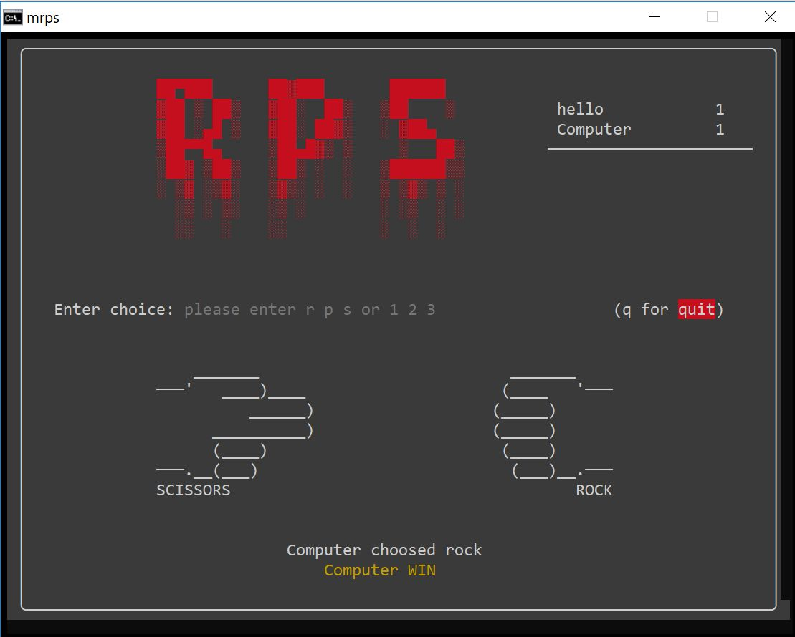
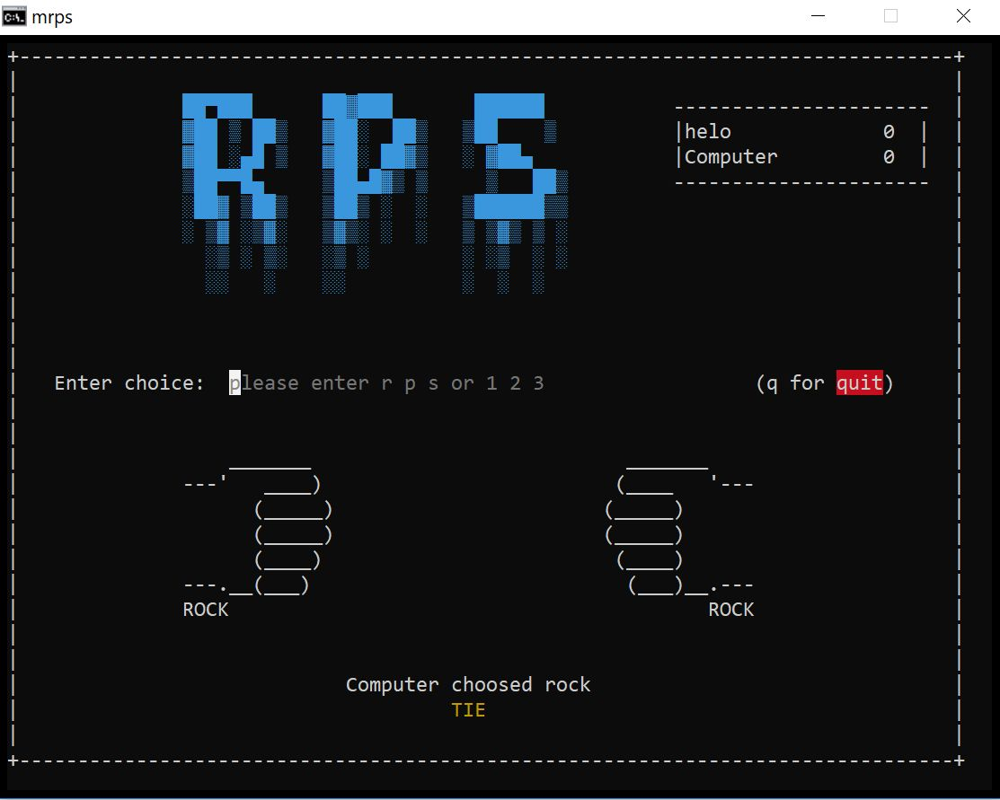

## Rock Paper Scissors 
An old school game running from years represented in a different way

### System Requirements
Windows 10: Version 1511 or newer

### Features
- legacy mode for much faster performance
- Lightweight & fast binary written in c
- no huge external libraries

### Preview

### TODO
- [x]  display winner name when exit
- [ ]  better handling on linux
- [ ]  design game main menu
- [ ]  custom user themes
- [ ]  new animation styles for opponent choice

## Special Thanks

- [patorjk](https://www.patorjk.com/software/taag) for bloody rps logo
- [wynand1004](https://gist.github.com/wynand1004) for ascii art
- [fnky](https://gist.github.com/fnky/458719343aabd01cfb17a3a4f7296797) for ansi escape sequences & color codes
- [Microsoft Documentation](https://learn.microsoft.com/en-us/windows/console/console-functions) and StackOverflow for windows console api reference

